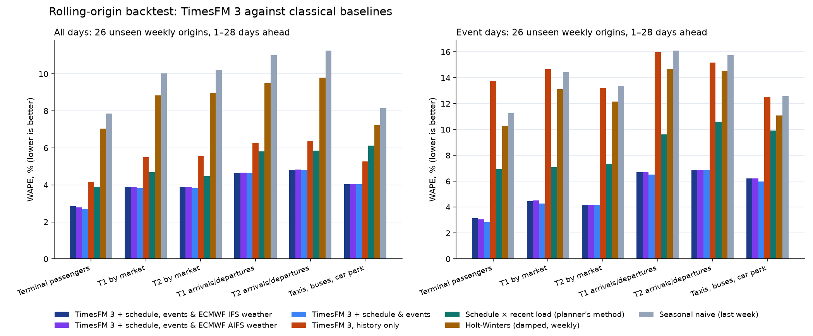

# Dublin Airport: forecasting and operations twin

A forecasting system for a **synthetic** Dublin Airport, built on [TimesFM 3](https://research.google/blog/timesfm-3-a-zero-shot-foundation-model-for-multivariate-forecasting/) (zero-shot, no fine-tuning), and a whole-airport simulation that is rostered from it.

- The daily history is invented, but two things are real:
  - **Traffic:** every month matches the Central Statistics Office's published Dublin Airport figures (total passengers, destination mix, arrival/departure split).
  - **Weather:** every day carries **Dublin Airport's real weather** from Met Éireann and METAR, and the **ECMWF IFS and AIFS forecasts exactly as they were issued**.
- Terminals, markets, landside flows and every operational number are illustrative, not daa data.

## What it does

| | |
| --- | --- |
| **Forecast** | 28 days ahead, refreshed the evening before each day, for terminals, destination markets, arrivals and departures, taxis, buses and car parks. TimesFM 3 reads the history plus what is known in advance (published schedule, events, school holidays, event direction, the weather forecast) and what is only known afterwards (delays, cancellations, observed weather). |
| **Measure** | A rolling-origin backtest over 52 weekly origins against four classical baselines. Point error, interval coverage and quantile loss, with bootstrap intervals so small slices are not over-claimed. |
| **Calibrate** | Conformal bands (P5 to P95), recalibrated at each origin on everything known by then. Event days and weather-risk days are calibrated separately. |
| **Reconcile** | MinT so that arrivals + departures = market and markets = terminal. |
| **Explain** | Exact Shapley values of the covariate groups (schedule, events, calendar, weather), from 8 or 16 TimesFM runs per family. |
| **Weather** | Disruption risk from ECMWF IFS (physics) and ECMWF AIFS (AI), scored against climatology. The weather forecast is used in TimesFM only when its own risk model flags a day. |
| **Ask what if** | TimesFM re-forecasts the day if an event is announced, 10% of flights are cancelled, or a route is added. Fog and storm scenarios run through the runway model. |
| **Describe what happened** | Type a scenario in words ("three T1 lanes fail at 7am", "fog until 10", "a crash on the M1"). It becomes the twin's shocks (an LLM interprets it if `scenario_server.py` is running: Gemini by default, or Claude; a built-in parser if not). The day then runs with and without them, and the twin shows where the effect appears first and how it spreads through the airport. |
| **Three horizons** | The 28-day plan, the evening-before refresh for the week ahead, and an hour-by-hour forecast for today that updates live (a nowcast) as passengers arrive. |
| **Real layout** | Piers, gates, stands and walking distances from OpenStreetMap. Passengers allow for the walk to far gates, and the twin draws a true-to-scale map of Dublin with the live aircraft and people on it. |
| **Decide** | The twin rosters security, passport control, taxis and shuttles from any forecast quantile. It shows each roster's cost against its risk before the day, then what actually happened. |

## Results

Scored 1–28 days ahead, on the 26 weekly origins (August 2025 to January 2026) that the calibration never saw. WAPE is weighted absolute percentage error; lower is better.

| Series | TimesFM + schedule, events, gated weather | TimesFM, history only | Planner's method¹ | Holt-Winters | Last week |
| --- | --- | --- | --- | --- | --- |
| Terminal passengers | **2.6%** | 3.8% | 3.6% | 6.8% | 7.6% |
| … on event days | **3.3%** | 12.6% | 6.3% | 8.9% | 10.3% |
| Passengers by market | **3.7–3.8%** | 5.2–5.4% | 4.2–4.5% | 8.5–8.7% | 9.8–9.9% |
| Arrivals/departures by market | **4.7%** | 6.1% | 5.7% | 9.4–9.5% | 10.9–11.0% |
| Taxis, buses, car park | **4.1%** | 5.2% | 6.3% | 7.0% | 8.0% |



¹ Next period's published schedule × the passengers per scheduled movement on the same weekday over the last four weeks. It is the honest competitor, because it uses the schedule too.

**Is the gain real?** The 95% bootstrap interval (over origins) for TimesFM-with-covariates minus each baseline excludes zero for every family, on all days and on event days. For terminals:

| Comparison | Difference, WAPE points [95% interval] |
| --- | --- |
| vs the planner's method | −1.0 [−1.2, −0.7] |
| vs history-only TimesFM | −1.2 [−1.6, −0.9] |
| vs history only, on event days | −9.3 [−10.5, −8.1] |

**Are the bands honest?**

| Band | Share of actuals inside |
| --- | --- |
| 80% band, after calibration | 79–82% |
| 90% band, after calibration | 89–91% |

- The calibration is *online*: each scored origin uses every forecast whose outcome was already known.
- Coverage is a little under target in winter, when real weather makes errors larger than in the calmer months the bands learned from.
- The reliability diagram ([docs/calibration.png](docs/calibration.png)) is also in the Forecast Studio.

**Reconciliation.**
- MinT makes the hierarchy add up exactly; the base forecasts disagree by about 110 passengers a day.
- Since real weather entered the history, this coherence costs a little accuracy: terminals 2.62% → 2.69%, markets 3.74% → 3.78%. Correlated disruption-day errors make the shrunk covariance less helpful.
- Coherent rosters are worth it, but it is a trade-off, not a free gain.

**March 2026 holdout** (one month, the data the demo replays):
- **Plan made on 1 March:** 3.4% error on Terminal 1, 1.8% on Terminal 2, against 5.0% and 5.0% from history only.
- **Refreshed the evening before each day**, with the latest passengers and the latest weather forecast: pooled error across the series falls from 5.3% to 3.4%.
- 72% of series-days fell inside the 80% band: a hard month, below the backtest's 79–82%.
- **One known problem:** T2's long-haul market (Middle East and Asia, about 1,000 passengers a day) is planned at roughly three times its actual level, because its history has a level shift. It is left out of the pooled figures above. The evening-before refresh recovers most of it.
- **The real calendar moved March:** with the real holidays, the synthetic March is a different draw. The plan's pooled error was 4.2% before the calendar change and is 5.3% now, while the 26-origin backtest improved (terminals 2.71% → 2.62%). One month is a small sample.

### Why these numbers are believable

An earlier version of this project reported about 0.6% error on event days. That was leakage: the "schedule" covariate was the realised flight count, and passengers were the schedule times a constant. Now:

- **The schedule covariate is the published schedule.** On the day, real weather cancels flights and ad-hoc flights are added. Those realised counts, delays, the cancelled share and the observed weather are past-only covariates.
- **Passengers = operated seats × load factor.** The load factor has its own persistent demand drift (AR(1), φ = 0.93), its own weekly pattern, school-holiday lift, and an event lift of random size that no covariate reveals. The event flag says "busier", not "how much".
- **Weather forecasts are the ones that were actually issued.** Horizon day *j* uses the ECMWF run from *j*+1 days before the origin; beyond 7 days it uses climatology. `tests/test_weather.py` checks this.
- **Market schedules come from the expected market share**, not the realised one.
- **`tests/test_data.py`** checks that Storm Éowyn's operated flights fall well below the published schedule, and that passengers per scheduled movement still vary.

## Weather

**Sources**, all cached in `reference_data/weather/` by `weather_data.py`:

| Source | What it provides |
| --- | --- |
| [Met Éireann, Dublin Airport station 532](https://data.gov.ie/dataset/dublin-airport-hourly-data) (CC BY 4.0) | Hourly rain, temperature, wind, visibility and cloud |
| [METAR for EIDW via the Iowa Environmental Mesonet](https://mesonet.agron.iastate.edu/) | Gusts, ceiling, fog, snow and freezing codes |
| [ECMWF](https://www.ecmwf.int/en/forecasts/datasets/open-data) IFS 0.25° (physics) and AIFS (machine learning), CC BY 4.0, through the [Open-Meteo Previous Runs API](https://open-meteo.com/en/docs/previous-runs-api) | Each day's forecast as issued 1–7 days earlier, from February/March 2024. Open-Meteo's free API is for non-commercial use. Neither archive carries gusts or visibility, so wind comes from mean wind and pressure, and fog risk from the dew-point depression. |

Met Éireann's archived warnings end in August 2023, so warnings are not used.

**Real disruptions drive the history.**
- Storm Darragh (7 Dec 2024) and Storm Éowyn (24 Jan 2025) cancel about 30% of flights.
- Freezing fog, snow, strong winds and frost add cancellations and delays.
- Rain lifts taxi demand by 6% and trims buses by 3%.
- The rules are in `weather_data.disruption` and are illustrative.
- In March 2026 the real weather brought a wet, windy 12 March (gusts 42 kt, 21 mm of rain), snow showers on the 13th and 15th, frosty mornings, and blustery 24–25 March.

**Disruption risk** (`weather_risk.py`): Brier skill against climatology on the later half of the archive; above zero adds information.

| Target | IFS 1–3 days | AIFS 1–3 days | IFS 4–7 days | AIFS 4–7 days |
| --- | --- | --- | --- | --- |
| Any weather disruption | 0.05 | 0.06 | 0.00 | 0.05 |
| Gusts ≥ 45 kt | 0.21 | 0.23 | 0.08 | 0.09 |
| Snow or ice | 0.06 | 0.03 | 0.05 | 0.03 |
| Low visibility ≥ 2 h | 0.09 | 0.07 | 0.00 | 0.03 |

- **Wind:** IFS forecasts it more accurately (day-ahead error 2.1 kt against 2.6 kt for AIFS).
- **Risk at 4–7 days:** AIFS holds its skill better.
- **12 March:** both raised the disruption risk from about 10–16% a week ahead to 20–21% the evening before, against a usual 5%.

**Weather in TimesFM.** The honest result:

| Model | All days | Disrupted days, 1–7 days ahead |
| --- | --- | --- |
| No weather | 2.62% | 8.60% |
| + IFS weather, always on | 2.72% | 8.24% |
| + AIFS weather, always on | 2.66% | 8.13% |
| **AIFS weather, only when its risk model flags the day** | **2.61%** | **8.12%** |

- **Always-on weather hurts on ordinary days.** It is noise there: +0.10 points for IFS [0.02, 0.18] and +0.04 for AIFS [−0.02, 0.10].
- **The gated model is never worse.** It gains on disrupted days in the first week: −0.48 points [−1.32, −0.05] for terminals and −0.45 [−1.22, −0.03] for landside.
- **The sample is small:** only 9 such days are in the scored half, so treat the gain as promising, not proven.
- **The production model is gated AIFS,** chosen on the calibration origins with a tie-break fixed in advance.
- **Weather is a 1–7 day signal,** which is why the twin's rosters can be switched to the plan refreshed the day before.

**In the twin** (`flow_demo/js/weather.js`): each March day replays its real hourly weather.
- **Runway rate** (illustrative): 64 movements/h on dual runways; 30 under low-visibility procedures; ×0.75 in crosswind gusts; near-suspension in storm-force gusts. Arrivals and departures queue for slots.
- **De-icing** on frosty mornings.
- **Rain** pushes arriving passengers to taxis.
- **On the map:** a weather badge with wind, visibility and the runway in use; fog haze and rain streaks.
- **Alerts** use the day-before disruption risk.
- **Scenarios:** "Low visibility 06–11h" and "Storm (red warning)".

## Data provenance

`real_data.py` reads two tables from the [CSO PxStat API](https://www.cso.ie/en/statistics/transport/aviationstatistics/) (CC BY 4.0) into `reference_data/cso_dublin_monthly.csv`:

- **TAM08**: monthly passengers at Dublin.
- **TAM07**: passengers and commercial flights by country and direction.

The synthetic daily series are scaled with smooth monthly factors so that every month's total matches TAM08 exactly. Each market's monthly passengers match TAM07's country mix (mapping in `real_data.py`), and the departing share follows TAM07's direction split.

The split between terminals (Europe city and UK 55/45 across T1/T2; sun routes all T1; North America and long-haul all T2) is the demo's assumption, not daa's allocation.

**The calendar is real.**
- Ireland's bank holidays come from the [Nager.Date](https://date.nager.at) API, including St Brigid's Day, which the old rules missed.
- Irish school breaks are the Department of Education's standardised Christmas, Easter and mid-term dates (`calendar_data.py`, `reference_data/calendar/`). Summers are approximate.
- The synthetic demand responds to the same flags, so this makes the simulated world more realistic rather than proving a gain.

**Real flights.** `real_flights.py` backfills every flight at Dublin from the [OpenSky Network](https://opensky-network.org) (ADS-B; research use; a free API client) into `reference_data/flights/eidw_daily.csv`, by airline group and market. So far it covers 26 January to 31 March 2026, and it resumes each time it runs until 2023 is reached.
- **Coverage:** OpenSky's commercial movements come to 101% of CSO's commercial flights in February and March 2026, within CSO's rounding. It sees essentially every flight.
- **Against the synthetic schedule:** the level matches (real passenger-airline movements average 100% of synthetic), but the day-to-day correlation is only 0.59.
- **Weekday shape:** real Tuesdays and Wednesdays are much quieter (0.82 and 0.86 of average) and Saturdays busier (1.07, against 0.93 in the synthetic schedule).
- **Next step:** the real schedule can replace the synthetic one once the backfill reaches back far enough. The full report is in `outputs/flights_report.md`.

The airport layout comes from [OpenStreetMap](https://www.openstreetmap.org/copyright) (ODbL), cached in `reference_data/osm/` by `airport_geometry.py`: the real gates (102-119, 201-224, 301-307A, 332-337, 401-426, the South Gates), the stands they serve, terminals, aprons, taxiways, runways and car parks. Pier centrelines and security exits are traced by hand; see `reference_data/SOURCES.md`.

The rolling 12-month total to June 2026 is 37.4 million passengers. It is shown against the 32 million passenger cap in the 2007 Terminal 2 planning permission, as a reference line only; that cap has been the subject of ongoing planning and legal proceedings.

## Run

```bash
python3.12 -m venv .venv
source .venv/bin/activate
pip install -r requirements.txt
python run_all.py
```

`run_all.py` runs four stages:

1. **Data.** Synthetic series calibrated to CSO.
2. **Backtest.** `forecast_eval.py`: 52 origins, about 2 minutes on an M-series Mac.
3. **Final forecast.** `forecast_final.py`: March forecast, calibration, MinT, Shapley values and scenarios, about 2 minutes.
4. **Export.** Writes `flow_demo/flow_data.js` for the twin.

The first run downloads `google/timesfm-3.0-pytorch` (about 1.3 GB). Every TimesFM call is cached in `outputs/cache/`, keyed by a hash of its inputs, so re-runs take seconds.

Other commands:

- `python run_all.py --data-only`: write the CSVs only.
- `python real_data.py`: refresh the CSO figures.
- `python calendar_data.py`: refresh the public holidays (`--show` prints the calendar).
- `python real_flights.py --max-hours 1`: continue the OpenSky backfill (needs `reference_data/flights/credentials.json`, an OpenSky API client; about 66 days per day of credits). `--report` writes the coverage report.
- `pytest`: run the tests (metrics, conformal calibration, MinT, data invariants).

Outputs:

| Path | What it holds |
| --- | --- |
| `outputs/backtest.csv.gz` | Every forecast from every origin and model, with deciles and calibrated levels |
| `outputs/leaderboard.csv`, `outputs/comparisons.csv` | WAPE, MASE, bias, WQL and coverage by family and slice; differences with bootstrap intervals |
| `outputs/reconciliation.csv` | Error before and after MinT |
| `outputs/leaderboard.png`, `outputs/calibration.png` | The two summary charts |
| `outputs/forecast_bundle.json` | The production forecast with bands, explanations, scenarios and track record |

The original single-origin scripts (`forecast_dublin_airport.py`, `forecast_markets.py`, `forecast_operations.py`) still run on their own and draw the classroom figure. `run_all.py` is the main pipeline.

TimesFM 3 weights are under the [TimesFM Non-Commercial License v1.0](https://huggingface.co/google/timesfm-3.0-pytorch); this is a demonstration, not a production system. On Apple silicon it uses the MLX backend.

## Code map

| File | Role |
| --- | --- |
| `forecast_dublin_airport.py` | Terminal series (published schedule, operated flights, load factor), the TimesFM loader |
| `forecast_markets.py`, `forecast_operations.py` | Markets, direction, landside, car-park stocks |
| `real_data.py` | CSO data and monthly calibration |
| `pipeline.py` | Forecast families, covariate groups, as-issued weather rows, cached TimesFM engine, Shapley values |
| `weather_data.py`, `weather_risk.py` | Real observations and as-issued ECMWF forecasts; disruption-risk models |
| `baselines.py`, `metrics.py` | Classical baselines, metrics and bootstrap (numpy only) |
| `calibration.py` | Conformal bands (normalised CQR; Mondrian by event and weather-risk day; online in the backtest) |
| `reconcile.py` | MinT with Schäfer–Strimmer shrinkage |
| `forecast_eval.py`, `forecast_final.py`, `run_all.py` | Backtest, production forecast, orchestration |
| `calendar_data.py` | Real public holidays (Nager.Date) and the curated Irish school calendar used by the forecast |
| `real_flights.py` | Real flights at Dublin from OpenSky: resumable backfill, daily aggregate, coverage report against CSO |
| `airport_geometry.py` | Real piers, gates, stands and walking distances from OpenStreetMap; writes `flow_demo/js/airport_geo.js` |
| `scenario_server.py` | Serves the twin; Gemini (or Claude) interprets scenarios and writes the impact briefing (optional) |
| `flow_demo/` | The operations twin (below) |

## Operations twin (`flow_demo/`)

```bash
python -m http.server 8765 --directory flow_demo   # then open http://localhost:8765
python scenario_server.py                          # the same, plus Gemini for scenarios: http://localhost:8770
python scenario_server.py --provider claude        # or Claude
```

You can also open `flow_demo/index.html` straight from disk; there is no build step. `scenario_server.py` uses Gemini by default: it needs `pip install google-genai` and `GEMINI_API_KEY` (model `gemini-4-argon`; set `GEMINI_MODEL` to use another). With `--provider claude` it needs `pip install anthropic` and `ANTHROPIC_API_KEY` (model `claude-opus-5-5`, or `CLAUDE_MODEL`). The key stays on the server. Without one, the twin uses its built-in parser.

Each dot is one person:

- filled dots depart and rings arrive
- connecting passengers, meeters and greeters, and staff are dots too
- cars, taxis, buses, shuttles, tugs and bags move on their own networks

The map stacks the terminals by level: departures, roads, arrivals, the baggage hall and car parks. The terminal blocks are schematic. The airside above them is real: every pier, gate and contact stand comes from OpenStreetMap at true scale. The view is turned so real west is up, which puts T2's Pier 4 on the left and T1's Piers 1–3 on the right. Remote stands (the South Gates, West and North Aprons) sit in a block at the west edge, not to scale, with real bus times. Outlet, lounge, carousel and car-park names come from daa's public terminal map; their capacities and all spend figures are illustrative.

**Walking distances.** The walk from security to each gate follows the real pier. In the twin it is within about 5% of the OpenStreetMap distance: 580–890 m to Pier 1 (8–12 minutes at 1.25 m/s), 280–420 m to Pier 2, about 200 m to Pier 3, and 130–500 m to Pier 4. Where the schematic draws a leg longer or shorter than it really is (inside the terminals, the T1–T2 link), walking speed on that leg is scaled so the time stays real.
- **Gate call times:** passengers leave the lounge earlier for a far gate, as the airport's screens advise. Remote stands board earlier by the length of the bus ride, and arriving passengers from remote stands reach passport control later by the same amount.
- **Arrivals:** they walk back along the real pier, so a Pier 1 arrival reaches passport control minutes after a Pier 3 one.
- **Departures tab:** a **Walk to the gate** table shows metres and minutes per pier, for an average traveller and for reduced mobility (0.6 m/s), with today's flights and missed flights per pier. The follow card gives each passenger's walk at their own pace.

**Real map** (key **S**): Dublin Airport north up and to scale, from OpenStreetMap: runways, taxiways, aprons, stand lines, terminals, piers and gates. Aircraft sit on their real stands, contact and remote. People on the piers and at the gates are drawn where they really are, because the twin's piers are the real ones turned. People inside the terminals are placed in each main hall's real footprint, with both levels sharing it, so those positions are approximate.

**Forecast Studio** (key **F**):

- A fan chart with calibrated bands; actuals are revealed up to the selected day.
- The week-ahead track record over the backtest year.
- The leaderboard with bootstrap intervals and the reliability diagram.
- The Shapley "why" for the selected day, with the scenario re-forecasts.
- **Week ahead:** the next seven days from the 1 March plan against the refresh made each evening, with the actual (the refresh's 80% band is narrower).
- **Today, hour by hour:** departing passengers reaching security, or arrivals reaching passport control.
  - **How it is built:** the TimesFM daily forecast spread over the day by the published timetable, flight by flight, using each traveller type's show-up pattern before departure (or the scheduled arrival, a typical delay, taxi-in, deplaning and the walk).
  - **Bands:** the daily band combined with the hourly shape's error, measured leave-one-out on the other 27 days.
  - **Live nowcast:** as the day plays, what has arrived so far updates the day's total (normal-normal on the log scale), and the bands for the hours still to come narrow. For passport control the nowcast uses actual landing times, which the airport knows live.
  - **On the bottom timeline:** the same nowcast band, per quarter hour.
  - **Backtest over March** (each day calibrated on the other 27), rest-of-day error before → after the nowcast, plan made 1 March:

    | Cut | Security | Passport control |
    | --- | --- | --- |
    | 08:00 | 6.0% → **3.6%** | 4.5% → 4.6% (too few flights have landed) |
    | 12:00 | 6.5% → **3.2%** | 4.5% → **3.5%** |
    | 16:00 | 6.3% → **4.3%** | 5.0% → **3.5%** |

    Hourly 80% bands held 89% of terminal-hours at security and 86% at passport control (slightly cautious). The nowcast starts once 10% of the expected day has arrived.
- The CSO data behind the history.

**Roster & risk:**

- Presets **1 2 3**: history only, covariates P50, covariates P90. A **risk-appetite slider** (keys **[ ]**) rosters for any calibrated quantile from P50 to P95. A switch chooses the plan made on 1 March or the plan **updated the evening before** (latest passengers and weather).
- **Cost against risk.** Each security roster is plotted by its cost in staff-hours and illustrative €, against the share of passengers expected through within 15 minutes. That share is measured before the day, by queueing the forecast's whole distribution (P5 to P95) through the same model, and set against what the actual day delivered.
- The app recommends the cheapest roster that keeps 95% of passengers within 15 minutes.
- **Alerts** list the windows that break the service level if demand lands on P90. One click adds the lanes or booths that fix them.
- The **outlook table** compares every roster on the actual day: peak wait, share within the service level, and staff-hours.

**Describe what happened** (the What if tab; key **I** reopens the impact view):

- **Shocks:** the text becomes a list of shocks, each with a type, a terminal, a time window and a size. There are 19 types:
  - **Security and check-in:** lanes out, screener shortage, power cut or evacuation, check-in system outage.
  - **Baggage and passport control:** baggage-screening failure, passport-officer shortage, eGates down.
  - **Runway and flights:** runway capacity, fog/storm/snow, flight delays, cancellations (by market or airline), demand changes, extra flights.
  - **Landside:** road congestion, bus strike, taxi shortage, car park closed.
  - **Piers:** pier closed, travelators out.
  - Every shock can be edited (hours, size) or removed, then re-run.
- **Interpreter:** an LLM when `scenario_server.py` is running: Gemini (`gemini-4-argon`) by default, or Claude (`claude-opus-5-5`) with `--provider claude`, both with structured output against the same schema. Otherwise a rule-based parser. The model only sets the direct shocks; it never invents knock-on effects.
- **The knock-on effects are simulated, not scripted.** The shocks are wired into the twin itself, so a lane failure becomes a queue, then missed flights, then less time and money spent airside. Fog becomes runway holding, then more aircraft on remote stands, a later passport-control peak, busier reclaim and a later taxi rush.
- **Impact view:** the day runs twice under the same roster, without and with the scenario, using common random numbers. Generation uses separate seeded streams per terminal, phase and flight, so nothing changes until the scenario does. Each part of the airport is measured every quarter hour. The view shows:
  - a ripple diagram, numbered in the order the effect reached each part, with a time scrubber;
  - a heat strip of the change through the day;
  - the day's KPIs with and without the scenario;
  - a briefing (the LLM's, from the measured numbers, or a template);
  - the hourly forecast with and without the scenario.
- **The forecast, when told:** cancellations and added flights scale TimesFM's own re-forecasts (10% cancelled; +6 movements); demand changes apply the stated change. The URL keeps the scenario text, so a view can be shared.

**Or pick a what-if** (applies to the selected day):

- **Demand scenarios:** announce an event, cancel 10% of flights, add a route. "Tell the forecast" scales the covariate rosters by TimesFM's own re-forecast; the history-only model cannot be told.
- **Capacity scenarios:** low visibility 06–11h, a storm with a red warning (both through the runway model), three T1 lanes out, eGates down, taxi shortage.

**Present:**

- **T** runs a guided tour of about 4 minutes.
- **R** opens a printable daily ops briefing (forecast, reasons, roster by hour, cost, risk, alerts) with a roster CSV export.
- **?** shows help.
- The URL keeps the day, time, roster and scenario, so a view can be shared.

| Key | Action |
| --- | --- |
| Space, ← → | Play/pause; jump 15 minutes |
| 1 2 3, [ ] | Roster preset; risk appetite down or up |
| W D A L B | Camera: whole, departures, arrivals, landside, baggage |
| S | Real map (OpenStreetMap, north up, to scale) |
| F, T, R, I, ? | Forecast Studio, tour, briefing, scenario impact, help |
| C, P | Dot colours, performance meter |
| Click | Follow a person (Esc to stop) |

**March in the twin.** All 28 days, people following actual demand and the real weather, rosters from each forecast:

| Roster | Missed flights | Mean daily security peak | Worst taxi-rank wait |
| --- | --- | --- | --- |
| History only | 1,023 | 15.3 min | 152 min |
| Covariates P50 | 453 | 5.4 min | 62 min |
| Covariates P90 | 378 | 4.4 min | 31 min |

**27 March.** Most missed flights under every roster fall on this day, the Friday the Easter school holidays start: 709, 451 and 376.
- T1's first wave is capacity-bound under any roster, and the real walk makes it worse.
- Under P50, 276 of the 451 were bound for Pier 1, 600–900 m from security. A 24-minute queue plus a 10-minute walk misses a 06:00 boarding close that the queue alone would have made.
- That is a capacity (and layout) problem, not a forecasting one.

History only also misses 314 on 5 March (summit departures). These figures changed with the real piers, walking times and calendar. Day generation now gives each terminal, phase and flight its own seeded stream (T1 keeps each day's original timetable), so individual days differ from earlier versions.

**Verification** (browser console):

- `DUB.runHeadless({ di, plan })` simulates a full day without drawing. It checks departures balance (boarded + missed = generated), arrivals, car-park bounds, sterility (no arriving passenger in the departures lounge), finite positions and gate conflicts.
- `DUB.runAllAsync(); DUB.status()` runs every day under every roster in the background.

**Rostering assumptions (illustrative):**

- 165 passengers per security lane-hour for an average traveller, adjusted for the traveller mix. Lanes are rostered at 95% utilisation per 30-minute slot, and the duty manager adds up to three surge lanes once the wait passes 20 minutes.
- Passport checks take 18 s (EU), 12 s (UK and Common Travel Area), 60 s (non-EU) and 22 s at eGates (15% are rejected to a booth). Booths are rostered at 90% utilisation.
- The taxi dispatcher calls 25% more cabs while a rank queue is over 40 parties.
- Costs: five screeners per lane at €38 an hour, €54 per officer-hour.
- Security opens at 02:30 in T1 and 03:30 in T2, the hours published on dublinairport.com.
